# 🧠 AI News Brief Generator

> An automated, production-grade intelligence pipeline that finds today's important AI and tech news across multiple premier sources, detects and removes cross-outlet duplicates, ranks stories using multi-source consensus, and synthesizes clean daily briefs across Markdown, HTML newsletter, JSON, and Slack.

---

## 🌟 Key Features

- **🌐 Multi-Source Concurrent Ingestion**:
  - Ingests from premier RSS feeds and live APIs in parallel with sub-second latency.
  - **Sources**: ArXiv (`cs.AI`, `cs.CL`), Hugging Face Daily Papers API, Hacker News Algolia API, TechCrunch AI, The Verge, Ars Technica, MIT Technology Review, Simon Willison's Weblog, MarkTechPost.
  - Domain-specific AI keyword filtering for general tech publications.
- **🔄 Intelligent Deduplication & Story Clustering**:
  - Exact URL canonicalization (strips `utm_*`, tracking tokens, query fragments).
  - Multi-metric title similarity combining Token Jaccard overlap, SequenceMatcher ratio, and token containment.
  - Groups syndicated and cross-reported articles into unified `StoryCluster` entities while preserving all reporting outlets and links.
- **📈 Multi-Factor Ranking & Scoring Model**:
  - **Base Relevance**: Domain keyword detection (reasoning models, autonomous agents, GPUs, frontier benchmarks).
  - **Recency Decay**: Exponential half-life decay prioritizing breaking developments.
  - **Source Authority**: Configurable editorial weights per publication.
  - **Multi-Source Consensus Bonus**: Stories covered by 2+ independent outlets receive a significant multiplier (`🔥 Cross-reported by 3 sources`).
  - **Virality Boost**: Algorithmic scoring of Hacker News points/comments and Hugging Face upvotes.
- **🏷️ Editorial Taxonomy & Categorization**:
  - 🚀 **Top Headlines & Breaking News**
  - 🔬 **Frontier Research & Breakthroughs**
  - 💼 **Industry, Big Tech & Capital**
  - 🛠️ **Open Source, Models & Developer Tools**
  - ⚖️ **Policy, Governance & Society**
- **💡 Analytical Synthesis & "Why It Matters"**:
  - Zero-dependency heuristic NLP extracts key metric sentences, implications, and entity tags (`#OpenAI`, `#Meta`, `#Google`, `#NVIDIA`, `#ReasoningModels`).
  - Optional Gemini LLM integration for executive briefings if API key is provided.
- **📦 Multi-Channel Publication**:
  - Clean GitHub-flavored **Markdown** brief with metric badges.
  - Responsive, dark/light **HTML Newsletter** email template.
  - Machine-readable **JSON Schema** for databases, bots, and APIs.
  - **Slack / Discord** incoming webhook dispatch blocks.
- **🖥️ Dual Interfaces**:
  - Full-featured **Streamlit Web Dashboard** (`web/app.py`).
  - Powerful **Command Line Interface** (`python -m src.cli`).
  - Automated **Daily Background Scheduler** (`src/scheduler.py`).

---

## 🏗️ System Architecture

```mermaid
flowchart TD
    subgraph S["📡 News & Research Network"]
        S1["ArXiv AI & CL"]
        S2["Hugging Face Daily Papers"]
        S3["Hacker News AI"]
        S4["TechCrunch AI"]
        S5["The Verge / Ars Technica"]
        S6["Custom RSS Feeds"]
    end

    subgraph I["1. Concurrent Ingestion Engine"]
        F1["Multi-Threaded Worker Pool"]
        F2["URL Canonicalizer"]
        F3["Time Window Filter (12h/24h/48h)"]
        F4["AI Keyword Classifier"]
    end

    subgraph D["2. Deduplication Engine"]
        D1["Exact Canonical URL Matching"]
        D2["Token Jaccard & Containment"]
        D3["Gestalt Sequence Matcher"]
        D4["Multi-Source Cluster Builder"]
    end

    subgraph R["3. Ranking & Classification"]
        R1["Recency Half-Life Decay"]
        R2["Virality & Upvote Scoring"]
        R3["Consensus Multiplier (2+ Outlets)"]
        R4["Editorial Category Classifier"]
    end

    subgraph B["4. Synthesis & Export"]
        B1["Entity & 'Why It Matters' Extractor"]
        B2["Executive Overview Synthesizer"]
        B3["Markdown Brief"]
        B4["HTML Newsletter"]
        B5["JSON API Feed"]
        B6["Slack/Discord Webhook"]
    end

    S --> I
    I --> D
    D --> R
    R --> B
```



---

## 🚀 Quick Start

### 1. Installation
Clone the repository and install dependencies:

```bash
git clone <repo-url>
cd "task 6"
pip install -r requirements.txt
```

### 2. Generate Today's Brief (CLI)
Generate today's brief from all sources in the past 24 hours:

```bash
python -m src.cli run --hours 24 --preview
```

### 3. Launch the Interactive Web Dashboard
Run the Streamlit web application:

```bash
python -m src.cli serve
# or
streamlit run web/app.py
```

Open `http://localhost:8501` in your browser.

---

## 🛠️ CLI Reference

The CLI supports several operational sub-commands:

```bash
# 1. Run the workflow and export to all formats
python -m src.cli run --hours 24 --top 5 --format all

# 2. Inspect active news sources and their authority weights
python -m src.cli sources

# 3. Test latency and connectivity to all sources
python -m src.cli test

# 4. Filter by specific sources
python -m src.cli run --sources techcrunch_ai,arxiv_ai,hf_daily_papers

# 5. Send daily brief directly to a Slack webhook
python -m src.cli run --webhook https://hooks.slack.com/services/...

# 6. Run the automated daily background scheduler (e.g. 08:00 UTC)
python -m src.cli schedule --hour 8 --minute 0
```

### CLI Arguments for `run`:
| Flag | Default | Description |
|------|---------|-------------|
| `--hours` | `24` | Lookback window in hours |
| `--top` | `5` | Number of top headlines in the lead section |
| `--format` | `all` | Output format: `markdown`, `html`, `json`, or `all` |
| `--output-dir` | `output/briefs` | Directory where briefs are saved |
| `--sources` | `None` | Comma-separated list of source IDs to fetch |
| `--similarity` | `0.58` | Deduplication similarity threshold (0.0 - 1.0) |
| `--preview` | `False` | Print Markdown brief directly to console |
| `--webhook` | `None` | Slack webhook URL to post formatted brief |

---

## ⚙️ Configuration

### Sources (`config/sources.yaml`)
You can enable, disable, reweight, or add new news and research sources:

```yaml
sources:
  - id: techcrunch_ai
    name: "TechCrunch AI"
    type: "rss"
    url: "https://techcrunch.com/category/artificial-intelligence/feed/"
    category: "industry"
    weight: 1.2
    enabled: true

  - id: hf_daily_papers
    name: "Hugging Face Daily Papers"
    type: "api_hf"
    url: "https://huggingface.co/api/daily_papers"
    category: "research"
    weight: 1.3
    enabled: true
```

### Settings (`config/settings.yaml`)
Tune ranking parameters, time decay, and deduplication sensitivity:

```yaml
deduplication:
  similarity_threshold: 0.58
  jaccard_weight: 0.45
  sequence_weight: 0.55

ranking:
  weights:
    base_relevance: 2.0
    recency: 2.5
    source_weight: 1.5
    multi_coverage_bonus: 3.0    # Boost when 2+ sources report the story
    virality: 1.5
  recency_decay_hours: 36.0
```

---

## 🧪 Testing

The repository contains an automated test suite verifying URL canonicalization, fuzzy duplicate detection, ranking models, recency decay, and brief generation:

```bash
pytest -v
```

---

## 📁 Output Artifacts

Generated daily briefs are saved to `output/briefs/`:
- `output/briefs/ai_news_brief_YYYY-MM-DD.md` — GitHub-flavored Markdown
- `output/briefs/ai_news_brief_YYYY-MM-DD.html` — Responsive modern HTML Newsletter
- `output/briefs/ai_news_brief_YYYY-MM-DD.json` — Machine-readable structured feed

---

## 📄 License
MIT License. Open for modification and integration into custom newsrooms, internal enterprise feeds, and Discord/Slack bots.
